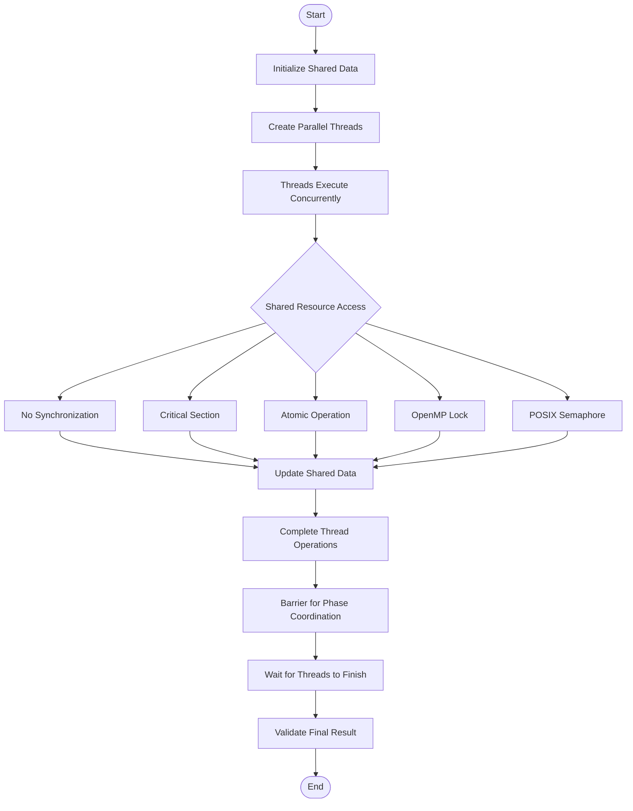

 <div align="center">

# SYNCHRONIZATION MECHANISMS IN PARALLEL PROGRAMS

### Implementation and Performance Analysis Using C, OpenMP and POSIX Threads


**A practical study of synchronization techniques for ensuring correctness and coordination in parallel programs.**

</div>

---

## Table of Contents

1. [Introduction](#1-introduction)
2. [Objectives](#2-objectives)
3. [Software and Technologies](#3-software-and-technologies)
4. [Synchronization Mechanisms](#4-synchronization-mechanisms)
5. [Synchronization Workflow](#5-synchronization-workflow)
6. [Project Structure](#6-project-structure)
7. [Environment Setup](#7-environment-setup)
8. [Compilation and Execution](#8-compilation-and-execution)
9. [Performance Evaluation](#9-performance-evaluation)
10. [Experimental Results](#10-experimental-results)
11. [Observations](#11-observations)
12. [Conclusion](#12-conclusion)

---

## 1. Introduction

Synchronization is a fundamental concept in parallel and concurrent programming. When multiple threads execute simultaneously and access shared resources, improper coordination can result in race conditions, lost updates, and inconsistent program outputs.

This experiment explores different synchronization mechanisms used in shared-memory parallel programming. It demonstrates how multiple threads can coordinate their execution and safely access shared data using different synchronization techniques.

The implementation uses the C programming language, OpenMP directives, and POSIX thread synchronization functions.

The experiment also compares selected synchronization mechanisms based on execution time and correctness under different thread configurations.

## 2. Objectives

- To understand race conditions in multithreaded programs.
- To study the importance of synchronization in parallel execution.
- To implement critical sections using OpenMP.
- To demonstrate atomic operations for shared-variable updates.
- To understand barrier synchronization among threads.
- To implement mutual exclusion using POSIX semaphores.
- To compare synchronization mechanisms based on execution time and correctness.
- To observe the effect of varying the number of threads on performance.

## 3. Software and Technologies

| Component | Technology |
|---|---|
| Programming Language | C |
| Parallel Programming Model | OpenMP |
| Thread Management | POSIX Threads |
| Synchronization Libraries | OpenMP and POSIX Semaphore |
| Compiler | GCC |
| Operating System | Ubuntu 22.04 LTS |
| Virtualization Software | VMware Workstation Pro |
| Compilation Tools | GCC with OpenMP and pthread support |

## 4. Synchronization Mechanisms

### 4.1 Race Condition

A race condition occurs when multiple threads access and modify shared data concurrently without proper synchronization.

The program demonstrates how simultaneous updates to a shared counter can result in lost increments and an incorrect final value.

### 4.2 Critical Section

The OpenMP `critical` directive ensures that only one thread at a time executes a protected block of code.

It provides mutual exclusion and prevents multiple threads from modifying shared data simultaneously within the critical region.

### 4.3 Atomic Operation

The OpenMP `atomic` directive ensures that a supported operation on a shared variable is performed atomically.

It is particularly suitable for simple operations such as incrementing a shared counter.

### 4.4 Barrier Synchronization

The OpenMP `barrier` directive establishes a synchronization point in a parallel region.

Every thread must reach the barrier before any thread can proceed beyond it. This helps coordinate different phases of parallel execution.

### 4.5 Semaphore

A semaphore is a synchronization mechanism used to control access to shared resources.

This experiment uses POSIX semaphore functions:

- `sem_wait()` – waits for and acquires the semaphore.
- `sem_post()` – releases the semaphore.

A binary semaphore is used to provide mutual exclusion while updating a shared counter.

### 4.6 OpenMP Lock

OpenMP locks provide explicit mutual exclusion between threads.

A thread must acquire the lock before entering the protected section and release it after completing the operation.

The OpenMP lock mechanism is included in the performance comparison program.

## 5. Synchronization Workflow

The workflow illustrates how multiple threads execute concurrently and how synchronization mechanisms coordinate access to shared resources.

### Execution Flow



### Workflow Explanation

1. **Initialization:** Shared variables and required synchronization objects are initialized.
2. **Thread Creation:** Multiple threads are created to execute tasks concurrently.
3. **Concurrent Execution:** Each thread performs its assigned operations.
4. **Synchronization:** When threads access shared resources, the selected synchronization mechanism controls access.
5. **Shared Data Update:** Threads perform the required operations on shared data.
6. **Thread Coordination:** A barrier can be used when all threads must complete a phase before proceeding.
7. **Completion:** The main program waits for the threads to finish and validates the final result.

*Note: The benchmark compares no synchronization, critical sections, atomic operations, and OpenMP locks. Barrier and semaphore synchronization are demonstrated in separate programs.*

## 6. Project Structure

The project contains six C source files demonstrating different synchronization mechanisms and a dedicated directory for experiment screenshots.

```text
sync_experiment/
│
├── race.c
├── critical.c
├── atomic.c
├── barrier.c
├── semaphore.c
├── compare_sync.c
│
├── pgc_screenshots/
│   └── Experiment execution screenshots
│
└── README.md
```

### Source File Description

| Source File | Description |
|---|---|
| `race.c` | Demonstrates race conditions |
| `critical.c` | Implements critical section synchronization |
| `atomic.c` | Implements atomic operations |
| `barrier.c` | Demonstrates barrier synchronization |
| `semaphore.c` | Implements POSIX semaphore synchronization |
| `compare_sync.c` | Compares synchronization performance |

## 7. Environment Setup

### 7.1 Prerequisites

The following tools are required:

- Ubuntu 22.04 LTS
- GCC compiler
- OpenMP support
- POSIX thread and semaphore support
- Terminal environment

### 7.2 Install Required Packages

Update the package repository:

```bash
sudo apt update
```

Install GCC and the required development tools:

```bash
sudo apt install build-essential -y
```

### 7.3 Verify Installation

Check the GCC version:

```bash
gcc --version
```

Verify OpenMP support:

```bash
echo '#include <omp.h>' | gcc -E -fopenmp -xc - > /dev/null && echo "OpenMP OK"
```

Check the number of available processors:

```bash
nproc
```

## 8. Compilation and Execution

Open the terminal and navigate to the project directory:

```bash
cd ~/sync_experiment
```

Compile and execute each program using the following commands.

### Program 1 – Race Condition

**Compilation:**

```bash
gcc race.c -fopenmp -o race
```

**Execution:**

```bash
./race
```

### Program 2 – Critical Section

**Compilation:**

```bash
gcc critical.c -fopenmp -o critical
```

**Execution:**

```bash
./critical
```

### Program 3 – Atomic Operation

**Compilation:**

```bash
gcc atomic.c -fopenmp -o atomic
```

**Execution:**

```bash
./atomic
```

### Program 4 – Barrier Synchronization

**Compilation:**

```bash
gcc barrier.c -fopenmp -o barrier
```

**Execution:**

```bash
./barrier
```

### Program 5 – Semaphore Synchronization

**Compilation:**

```bash
gcc semaphore.c -pthread -o semaphore
```

**Execution:**

```bash
./semaphore
```

### Program 6 – Synchronization Performance Comparison

**Compilation:**

```bash
gcc compare_sync.c -fopenmp -o compare_sync
```

**Execution:**

```bash
./compare_sync
```

## 9. Performance Evaluation

The `compare_sync.c` program evaluates four synchronization approaches using a shared counter.

### 9.1 Experimental Configuration

| Parameter | Configuration |
|---|---|
| Total Increment Operations | 10,000,000 |
| Synchronization Methods | None, Critical, Atomic, Lock |
| Thread Counts | 1, 2, 4, 8 |
| Execution Time Measurement | `omp_get_wtime()` |
| Correctness Verification | Final counter value |
| Expected Counter Value | 10,000,000 |

### 9.2 Evaluation Criteria

The performance comparison considers:

- **Correctness:** Whether the final counter value matches the expected value.
- **Execution Time:** The time taken to complete the operations.
- **Synchronization Overhead:** The additional time introduced by synchronization.
- **Scalability:** How performance changes with different thread counts.

## 10. Experimental Results

### 10.1 Execution Time Comparison

The following table presents sample execution times recorded during the experiment.

| Threads | No Synchronization (s) | Critical (s) | Atomic (s) | Lock (s) |
|:---:|---:|---:|---:|---:|
| 1 | 0.0486 | 0.1571 | 0.0567 | 0.1586 |
| 2 | 0.0249 | 0.1584 | 0.0574 | 0.1590 |
| 4 | 0.0250 | 0.1583 | 0.0585 | 0.1615 |
| 8 | 0.0250 | 0.1579 | 0.0565 | 0.1603 |

### 10.2 Race Condition Results

The following results illustrate the effect of unsynchronized access to a shared counter.

| Threads | Final Counter Value | Status |
|:---:|---:|---|
| 1 | 10,000,000 | Correct |
| 2 | 10,000,000 | Correct in this execution |
| 4 | 7,545,062 | Incorrect |
| 8 | 4,394,535 | Incorrect |

The expected counter value is `10,000,000`. The incorrect results demonstrate that concurrent updates without synchronization can cause lost increments.

### 10.3 Comparison of Synchronization Techniques

| Mechanism | Correctness | Performance Characteristics |
|---|---|---|
| No Synchronization | Not guaranteed | Low overhead, but unreliable results |
| Critical Section | Correct | Serializes access to the protected region |
| Atomic Operation | Correct for the protected update | Relatively low synchronization overhead |
| OpenMP Lock | Correct | Explicit locking introduces waiting overhead |

*Note: Execution times and race-condition results depend on processor resources, thread scheduling, virtual machine configuration, and system load. Race-condition results may vary between executions.*

## 11. Observations

1. Unsynchronized access to shared variables can result in race conditions and lost updates.
2. Critical sections ensure mutual exclusion but may increase execution time because threads must wait.
3. Atomic operations are suitable for simple shared-variable updates and generally introduce less overhead than larger protected sections.
4. Barrier synchronization ensures that all threads reach a common execution point before proceeding.
5. Semaphores provide controlled access to shared resources.
6. OpenMP locks allow explicit control over mutual exclusion.
7. Increasing the number of threads does not always improve performance because synchronization overhead and resource contention can limit parallel execution.

## 12. Conclusion

This experiment demonstrates the importance of synchronization mechanisms in parallel programming through the implementation of race conditions, critical sections, atomic operations, barriers, and semaphores.

The performance comparison illustrates the relationship between synchronization overhead, execution time, and correctness. It also highlights that different synchronization techniques are suitable for different requirements.

Atomic operations are useful for simple shared-variable updates, while critical sections, locks, barriers, and semaphores provide synchronization for broader coordination requirements.

**The experiment establishes that appropriate synchronization is essential for developing correct, reliable, and efficient parallel programs.**

---

<div align="center">

</div>
